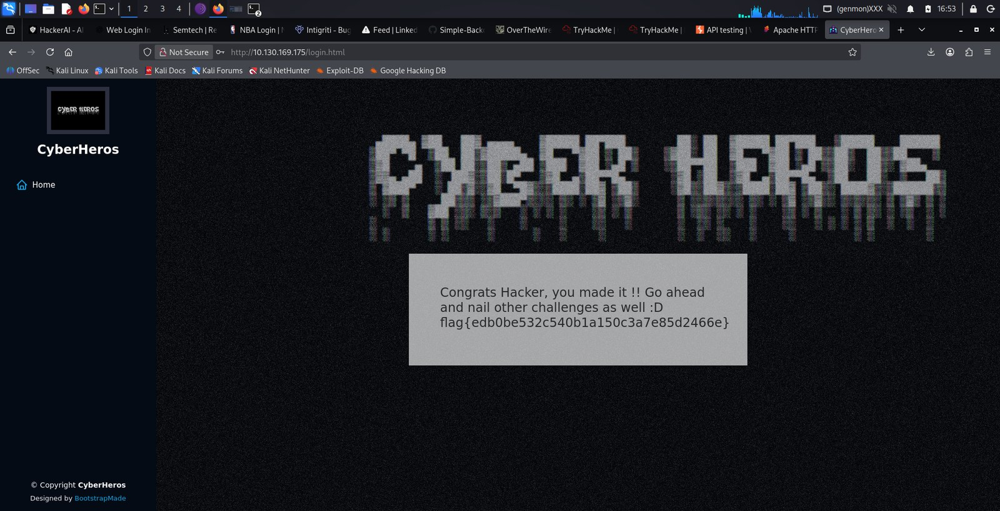

# TryHackMe: CyberHeros

**Platform:** TryHackMe  
**Challenge:** CyberHeros — uncover the flag  
**Category:** Web application security / authentication  
**Target used in this deployment:** `10.130.169.175`  
**Result:** Completed

> This report documents an authorised TryHackMe training exercise. The target IP is specific to the lab deployment and may change when the room is restarted.

## 1. Executive summary

The objective was to find a way to log in to the CyberHeros web application and retrieve the flag.

Initial network enumeration identified HTTP on port 80 and SSH on port 22. Since the homepage explicitly directed visitors to investigate its login page, I focused on the web application. Inspecting `login.html` revealed that the browser performed the credential comparison in inline JavaScript. The same source exposed a hardcoded username and a password that was merely reversed before comparison.

I reversed the supplied string, recovered the credentials, and used the page's login flow. The application then requested a text file whose name was assembled from a distinctive path prefix, the submitted username, and the submitted password. The response displayed the challenge flag.

**Primary findings:**

- Hardcoded credentials exposed in client-side JavaScript.
- The visible login decision is performed in the browser; the page source does not show a server-side credential-validation endpoint.
- Password reversal provided obfuscation, not protection.

## 2. Scope and environment

| Item | Detail |
|---|---|
| Platform | TryHackMe |
| Target | `10.130.169.175` (this deployment only) |
| Attacking system | Kali Linux |
| Web service | Apache HTTP Server 2.4.48 (Ubuntu) |
| Other exposed service | OpenSSH 8.2p1 |
| Tools used | Nmap, cURL, grep, Python 3, Firefox |

All activity described below was performed against the lab machine provided for this challenge.

## 3. Reconnaissance

I began with a service and version scan:

```bash
nmap -sC -sV -Pn 10.130.169.175
```

The scan reported:

| Port | State | Service | Detected version |
|---|---|---|---|
| 22/tcp | Open | SSH | OpenSSH 8.2p1 Ubuntu 4ubuntu0.4 |
| 80/tcp | Open | HTTP | Apache httpd 2.4.48 (Ubuntu) |

The web server returned the page title `CyberHeros : Index`. Because the challenge prompt mentioned logging in, HTTP was the most relevant initial lead. I did not pursue SSH because the web application exposed a direct route to the challenge objective.

## 4. Homepage inspection

I retrieved the homepage headers and body:

```bash
curl -i http://10.130.169.175/
```

The HTML contained a navigation link to `login.html` and a message challenging visitors to find the vulnerability in the login page. This confirmed the login page as the next area to inspect.

The page was available at:

```text
http://10.130.169.175/login.html
```

## 5. Login page enumeration

I retrieved the login page and saved a local copy:

```bash
curl -i http://10.130.169.175/login.html
curl -s http://10.130.169.175/login.html -o login.html
```

I searched for form fields and authentication-related code:

```bash
grep -Ein 'form|action|method|input|name=|password|username|script|onclick|fetch|ajax' login.html
```

The relevant HTML elements were:

```html
<form id="todel" class="">
    <input type="text" id="uname" placeholder="username"/>
    <input type="password" id="pass" placeholder="password"/>
</form>

<button id="rm" onclick="authenticate()">login</button>
```

The button called a JavaScript function named `authenticate()`. The inputs had IDs but no `name` attributes, and the form did not specify a server-side `action` or `method`. This was a useful indication that the page handled the login logic in JavaScript.

## 6. Source-code analysis and credential recovery

The inline JavaScript contained the following logic:

```javascript
const RevereString = str => [...str].reverse().join('');

if (a.value == "h3ck3rBoi" &
    b.value == RevereString("54321@terceSrepuS")) {
    // Continue with the successful-login request
}
```

Two values were exposed directly in the browser-delivered source:

- Username: `h3ck3rBoi`
- Password input to the reversing function: `54321@terceSrepuS`

The function used JavaScript's `reverse()` operation to reverse the string. I reproduced that transformation with Python:

```bash
python3 -c 'print("54321@terceSrepuS"[::-1])'
```

The output was:

```text
SuperSecret@12345
```

The recovered lab credentials were therefore:

| Field | Value |
|---|---|
| Username | `h3ck3rBoi` |
| Password | `SuperSecret@12345` |

Reversing a password is only a reversible transformation. It is not encryption or password hashing, and it does not keep the value secret when the transformation and input are both shipped to the browser.

## 7. Understanding the successful-login request

The success branch created an `XMLHttpRequest` and sent a `GET` request. The requested filename was constructed in JavaScript from a distinctive hardcoded path prefix, the username, the password, and a `.txt` suffix.

The response handler placed the returned text into the page's element with the ID `flag`:

```javascript
if (this.readyState == 4 && this.status == 200) {
    document.getElementById("flag").innerHTML = this.responseText;
    document.getElementById("todel").innerHTML = "";
    document.getElementById("rm").remove();
}
```

This helped explain the observed behaviour: after the credential comparison succeeded in the browser, the page fetched a text resource and displayed its response. The authentication decision visible in the supplied client code is not, by itself, a secure substitute for independent server-side authentication and authorisation. The server-side implementation was not available for source review.

## 8. Validation and result

I opened the login page in Firefox and entered the recovered credentials. The application accepted them, removed the login controls, and displayed the success message and flag.

### Evidence: successful authentication



### Flag

<details>
<summary>Show flag</summary>

```text
flag{edb0be532c540b1a150c3a7e85d2466e}
```

</details>

## 9. Security assessment

### Finding 1 — Client-side authentication logic

**Observation:** The browser ran the credential comparison in inline JavaScript and only then initiated the request for the flag resource. The source available to every visitor disclosed the logic used by the page.

**Security significance:** A user controls their browser and can inspect or modify client-side code. A client-side check must not be the control that protects a server-side resource. The server must independently authenticate the user and authorise every protected request.

**Potential classification:** [CWE-603 — Use of Client-Side Authentication](https://cwe.mitre.org/data/definitions/603.html). This is the closest mapping to the client-side pattern visible in the page. CWE-603 specifically requires that authentication not also be performed by the server; because server-side source code was not available, that part was not independently verified in this exercise.

### Finding 2 — Hardcoded credentials

**Observation:** The username and reversible password string were embedded directly in the page's JavaScript.

**Security significance:** Values included in client-delivered source are available for inspection. Reversing the password string only obscured its presentation; it did not protect the credential.

**Relevant weakness:** [CWE-798 — Use of Hard-coded Credentials](https://cwe.mitre.org/data/definitions/798.html).

### What this test demonstrated

- The login page exposed the username and the reversible password representation.
- The credential transformation was recoverable with a simple string reversal.
- The recovered credentials worked through the page's login flow.
- The resulting HTTP response displayed the challenge flag.

I did not need to perform password brute-forcing, SQL injection, or SSH exploitation to complete this challenge. Those techniques were not part of the demonstrated attack path.

## 10. Remediation recommendations

1. **Move authentication to the server.** Submit credentials to a server-side authentication endpoint and validate them there. Never treat a JavaScript comparison as proof of identity.
2. **Remove secrets from frontend code.** Do not embed usernames, passwords, API keys, tokens, or other secrets in HTML or JavaScript delivered to users.
3. **Store password verifiers securely.** Store salted password hashes using a suitable password-hashing algorithm such as Argon2id or bcrypt; do not store plaintext or reversibly transformed passwords.
4. **Protect the flag resource itself.** The server must authenticate and authorise every request for a protected file or endpoint. Hiding the URL or constructing an unusual filename is not access control.
5. **Use secure sessions.** After successful server-side authentication, issue a properly protected session cookie (for example, `HttpOnly`, `Secure`, and an appropriate `SameSite` setting) and validate it on protected requests.
6. **Add abuse protections.** Apply rate limiting and appropriate monitoring to authentication endpoints.
7. **Use HTTPS.** Protect credentials and session data in transit.

## 11. Lessons learned

- Service enumeration helped identify the web application as the relevant attack surface.
- Homepage content and HTML source inspection provided useful direction before using heavier tools.
- Client-delivered JavaScript should be treated as public information, not a place to store secrets.
- Reversible transformations such as string reversal do not provide confidentiality.
- A successful authentication flow should be verified by observing the browser's actual request and response behaviour.
- A strong report distinguishes what the evidence proves from what has not been tested.

## 12. Conclusion

The CyberHeros challenge was completed by enumerating the target, identifying the login page, inspecting its JavaScript, recovering the hardcoded credentials, and using the intended login flow to retrieve the flag.

The central security lesson is that authentication and authorisation must be enforced by the server. Client-side code can improve usability, but it cannot be trusted to protect server-side resources.

---

**Author's note:** This is a training-lab case study, not a claim that the same weakness exists in any production service. The target IP and credentials belong only to this intentionally vulnerable lab environment.
